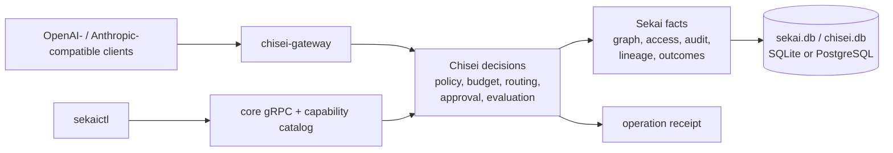

# sekai-chisei

**Define the world your agents operate in. Govern what they do. Keep the
receipt.**

[](https://github.com/Sannrox/sekai-chisei/actions/workflows/ci.yml)
[](https://github.com/Sannrox/sekai-chisei/releases)
[](LICENSE)

[Quick start](#quick-start) · [Docs](docs/README.md) ·
[Architecture](docs/architecture.md) · [Decisions](docs/decisions/README.md) ·
[Vision](VISION.md)

> **Project status:** stable 2.x. The ontology-first loop, SQLite persistence,
> principal credentials, policy pipeline, receipts, `sekaictl`, and core gRPC
> catalog form the stable 2.x contract. Advanced and experimental capabilities
> remain explicitly classified and require opt-in discovery.

Sekai (世界, "world") stores durable facts; Chisei (知性, "intellect") makes
governed decisions. Together they are a local-first Rust control plane for
governed agent operations: define a domain ontology, store governed facts under
that model, run plan and execution inside policy and budget, and inspect the
resulting receipt. Operators use `sekaictl`; agents and SDKs use the same core
gRPC and capability catalog interfaces. The control plane owns durable facts
and the decisions that constrain an operation. It does not replace the agent
runtime.

- **Ontology-first authoring.** Define domain classes and relations, then seed
  typed facts and links without adding domain concepts to the core protocol.
- **Governed execution.** Namespace access, policy, budgets, context egress,
  routing, evaluation, and approvals apply around plan and execution.
- **Inspectable outcomes.** Decisions, normalized usage, lineage, verification,
  action outcomes, and provenance are retained under a durable operation.
- **Compatible entry paths.** Existing OpenAI- and Anthropic-compatible
  clients enter through the gateway; native integrations use governed gRPC.
  Both paths run under the same control plane.
- **Local-first authority.** The stable 2.x graph and governance state live in
  SQLite by default. PostgreSQL is a first-class community backend for the
  dual-backend inventory; remaining experimental and admin SQLite-only
  surfaces fail closed, as do Chisei `PlanExecution` and
  `PlanContentExecution`.

## Quick start

### Prerequisites

- a recent Rust toolchain with Rust 2024 edition support;
- macOS, Linux, or another platform supported by Rust and SQLite.

`protoc` is supplied by a vendored build dependency.

### Run the ontology-first product loop

```bash
git clone https://github.com/Sannrox/sekai-chisei.git
cd sekai-chisei
cp .env.example .env
```

Start Combined in one terminal. `cargo run` reads the process environment
only; it does not load `.env` (`sekaictl launch` does). With no store
variable set, Combined opens split `./data/sekai.db` and `./data/chisei.db`:

```bash
SEKAI_INSECURE=1 cargo run
```

`SEKAI_DATA_DIR` moves that directory. The dest-pair from
[`.env.example`](.env.example) overrides the files explicitly:

```bash
SEKAI_INSECURE=1 SEKAI_DB_PATH=./data/sekai.db CHISEI_DB_PATH=./data/chisei.db cargo run
```

The retired single-store variables `DB_PATH`, `DATABASE_URL`, and
`SEKAI_SHARED_STORE` refuse boot; move an old single file with
[store relocation](docs/store-relocation.md). To run the planes
as separate processes, see
[two-plane processes](docs/two-plane-processes.md).

In another terminal, define a small service domain and seed facts:

```bash
cargo run --bin sekaictl -- ontology apply --file tests/fixtures/product_loop/domain-v1.json
cargo run --bin sekaictl -- ontology seed --file tests/fixtures/product_loop/seed-v1.json
```

```text
applied domain: kinds=1 classes=2 relations=1
  kind ensured: incident
  class: Service
  class: Incident
  relation: affects
seeded namespace "demo": objects=2 links=1
  object: svc-api
  object: inc-1
  link: link-affects-0
```

Then read the graph back through the structured semantic reads. These answer
from Sekai facts and require no external model:

```bash
cargo run --bin sekaictl -- ontology context --object inc-1 --depth 1
```

```text
context: candidates=2 links=1 truncated=false revision=
  object: inc-1 kind=incident depth=0 via=- derived=false
  object: svc-api kind=component depth=1 via=affects derived=false
  link: inc-1 -[affects]-> svc-api
```

The fixture files are domain-neutral examples; your domain concepts live in
your own ontology and seed documents. Continue with the
[ontology guide](docs/ontology.md) for apply, seed, expand, explain, governed
run, and receipt commands. The chained `ontology first-run` and the governed
`ontology run` route through the execution plane, which currently requires a
configured model provider even for lookup-eligible tasks
([#2108](https://github.com/Sannrox/sekai-chisei/issues/2108)).

Verify the service and repository:

```bash
cargo test --locked
curl --fail http://127.0.0.1:9464/healthz
```

The health probe answers `ok`.

`SEKAI_INSECURE=1` is only for trusted local development. Read the
[operations and security guide](docs/operations.md) before binding to a
network-accessible interface.

## How it works



The core product loop is deliberately small: define an ontology, seed governed
facts, plan and execute under policy and budget, then inspect the receipt and
its provenance.

- **Sekai** stores durable facts: typed objects and links, lineage, access
  control, audit history, coordination, and operational memory.
- **Chisei** makes governed decisions about context, policy, budgets,
  approvals, routing, evaluation, and learning.
- **Product interfaces** expose the same core loop to operators through
  `sekaictl` and to agents through gRPC and the capability catalog.

Combined mode runs both planes in one process over split stores; independently
runnable `sekai-plane` and `chisei-plane` processes each open only their own
store (see [two-plane processes](docs/two-plane-processes.md) and
[ADR 0082](docs/decisions/0082-separate-chisei-and-sekai-durable-stores.md)).

Provider adapters, the OpenAI- and Anthropic-compatible gateway, evaluation
plans, advanced retrieval, federation administration, and automated allocation
extend the platform. They are advanced or experimental capabilities, not the
stable product definition.

**Why not govern inside the agent framework?** Agent systems commonly lose
structured context across operations, cannot explain why a model, runtime, or
action was chosen, and lack hard controls for spend, access, and egress.
`sekai-chisei` keeps that governance in an inspectable local-first service that
operators control without coupling it to one agent, model provider, or domain
executor. The reasoning and product boundary are in [VISION.md](VISION.md).

## What works today

- SQLite-backed typed-object graph with schemas, links, and datasets, or
  `SEKAI_DB_BACKEND=postgres` for the same reusable community surface (no
  tenant/OIDC). Virtual-table RPCs are experimental (`SEKAI_EXPERIMENTAL_RPCS=1`);
- namespace-first access control, audit, lineage, and retention primitives;
- work-unit admission, heartbeat, completion, and reconciliation (experimental
  RPCs; `SEKAI_EXPERIMENTAL_RPCS=1`);
- policy resolution, context enrichment, budgets, model routing, and
  evaluation gates;
- governed actions with dry runs, risk classes, blast-radius limits, and
  public Action approval (`DecideActionInstance` / `ListActionInstances`);
- OpenAI Responses and Chat Completions compatibility;
- Anthropic Messages compatibility;
- native governed execution and streaming gRPC APIs;
- usage receipts, Prometheus metrics, health probes, and gateway reports; and
- external evidence adapters with retained source attribution.

The capability catalog returns only `core` entries by default; request
`product_tier_filter=all`, `advanced`, or `experimental` explicitly to expand
it. Core contracts are namespace-first and domain-neutral: namespaces, actors,
operations, attempts, actions, artifacts, verification, and outcomes. Domain
objects such as repositories, incidents, campaigns, or support tickets belong
in schemas and adapters rather than the core ontology.

For feature tiers and discovery details, see [Public RPC maturity](docs/rpc-maturity.md)
and the [capability catalogs](docs/capability-catalog.md).

## Next steps

Use the [documentation index](docs/README.md) to choose a guide by task.

- Try the [reference lookup-first domain pack](docs/ontology.md#reference-lookup-first-domain-pack).
- Connect Codex, Claude Code, or another supported client through the
  [compatibility gateway](docs/gateway.md#guided-launch).
- Use the standalone [local `sekai` ontology tool](crates/sekai-ontology/README.md)
  for portable ontology databases.
- Run a [domain-neutral example](examples/README.md) or read
  [CONTRIBUTING.md](CONTRIBUTING.md) to develop and test the project.

## Security

Report vulnerabilities privately using the process in
[SECURITY.md](SECURITY.md). Never commit credentials, tokens, local databases,
logs, or private keys.

For usage questions, reproducible bugs, and feature proposals, follow
[SUPPORT.md](SUPPORT.md).

## License

Licensed under the [Apache License, Version 2.0](LICENSE).
