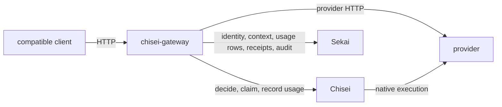
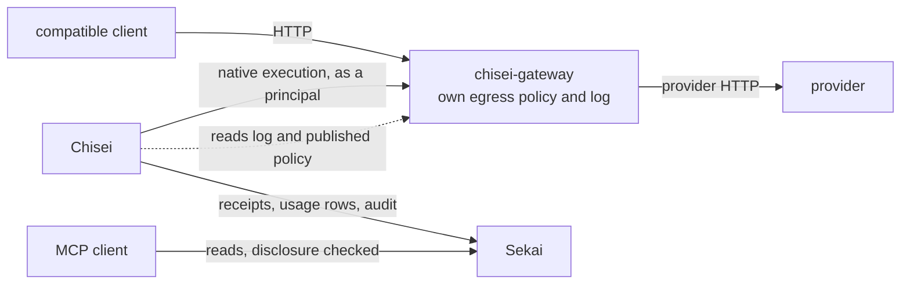

# ADR 0152: The gateway is the model egress layer, not an entry point to Chisei

- Status: accepted
- Date: 2026-11-18
- Owners: @Sannrox
- Discussion: none, resolved by the maintainer in #2695
- Issue: #2695
- Supersedes: [ADR 0008](0008-gateway-is-a-fail-closed-translator.md), [ADR 0151](0151-chisei-admits-every-model-call.md)
- Superseded by: none

## Context

ADR 0008 made the gateway a fail-closed translator that asks the control plane
for a live decision before every provider call. ADR 0151 named Chisei the
single admission point and kept two doors into it: native execution and the
gateway.

That shape made the gateway a second front door into Chisei. Today it speaks
three gateway-only Chisei RPCs (`DecideGatewayExecution`,
`ClaimGatewayDispatch`, `RecordUsage`) under the coordinated `gateway.decide/v2`
contract, eleven Sekai RPCs for identity, context injection, usage rows,
receipts, audit, and recovery, and runs as the reserved principal
`chisei-gateway`. Each separate write is a place where audit can be lost
(#2568 and recent audit fixes). The request path fails whenever the control
plane is unreachable. Test hooks for the gateway are compiled into
`sekai-core` and `chisei-core`. The gateway cannot be released or deployed
apart from this repository.

Compatible clients still need governed model egress. MCP gives them governed
data and actions but leaves their model calls ungoverned, so removing the
gateway is not an option.

Today the gateway sits between clients and both planes:

## Decision

After this decision every model call leaves through the gateway, and Chisei
only reads from it:

1. **One egress layer.** Every governed model call leaves through the
   gateway: compatible clients and Chisei's native execution alike. Chisei
   calls the gateway's compatible HTTP surface as an ordinary principal, with
   no special path. Provider keys live only in the gateway.
2. **Not an entry point.** The gateway exposes no Sekai or Chisei capability
   and never calls Sekai or Chisei. Chisei reads from the gateway; nothing
   writes into it except its operator.
3. **The gateway owns its egress policy.** Operator configuration on the
   gateway names its principals and their keys, the providers and models each
   may reach, per-principal and per-model rate limits and quotas, and data-class
   egress rules. Each loaded policy carries a generation. A gateway with no
   valid policy denies; a failed reload keeps the previous valid generation
   and never applies a partial policy.
4. **Policies do not overlap.** The gateway decides who may reach which
   provider, how fast, and how much. Chisei decides how an operation proceeds:
   planning, routing, context, evaluation, learning, and native budgets. Neither
   holds a copy of the other's rules.
5. **Quotas are local.** Each gateway instance enforces its quotas with its own
   counter, from its share of the configured quota. A small overshoot at the
   edges is accepted; an exact cross-instance spend ledger is not built.
6. **Record before forward.** The gateway appends an admission record to its
   own durable, ordered log before provider contact, and a usage record after.
   A failed append denies. Chisei reads each configured gateway's log by
   durable cursor, idempotent on request id, and writes receipts, `llm_calls`
   rows, and the decision log in Sekai.
7. **Disclosure is decided where data leaves Sekai.** The gateway carries no
   provenance and `chisei_context` is removed. Reads check each field's data
   class against the reading principal's allowed egress, which Chisei reads
   from the gateway's published policy. Gateway principals map to Sekai
   principals by name or by an explicit mapping in the gateway policy. A
   principal that may reach several routes gets the strictest answer. A
   principal with unknown egress, such as client-login passthrough or no
   gateway mapping, receives only data releasable on every route.
8. **Wire fidelity stays.** The gateway forwards compatible requests
   unchanged apart from authentication and the admitted route, including
   client cache controls.

## Alternatives considered

- **Keep ADR 0008.** Keeps one live decision per request, at the cost of a
  gateway-only contract, gateway writes into Sekai, request-path dependence on
  the control plane, and no separate release.
- **Slim ADR 0008 to two calls (decide, record).** Removes the Sekai writes
  but keeps the gateway as a door into Chisei and the request-path
  dependency.
- **Chisei pushes expiring policy and leased budget allotments to registered
  gateways.** Keeps one policy author, but needs a gateway registry, a push
  contract, and a distributed spend ledger that no workload has asked for.
- **Deprecate the gateway, MCP only.** Leaves model calls of unmodified
  clients ungoverned.
- **Last-known Chisei decisions at the edge.** Still rejected, as in ADR 0008.
  The gateway enforces its own policy, not cached Chisei verdicts.
- **Chisei issues every provider call, gateway translates only.** Every
  compatible request would pass through native normalization and lose wire
  fidelity.
- **Per-request route declaration for disclosure.** Finer than per principal.
  Deferred until a workload needs it.

## Consequences

- The gateway depends on no control-plane contract and can be released and
  deployed alone. Losing the control plane does not stop gateway traffic;
  receipts lag until Chisei reads the log again.
- Operators manage two configurations: the gateway's egress policy and Chisei's
  namespace policy. `sekaictl launch` writes both for local setups.
- Budgets for compatible clients become gateway quotas. Chisei budgets govern
  native operations. Quotas may overshoot slightly across instances.
- The gateway gains durable state (its log and its policy). Backup, restore,
  and rollback cover both, and a restarted instance resumes from them.
- Chisei gains configuration naming the gateways it reads from.
- Breaking: `DecideGatewayExecution`, `ClaimGatewayDispatch`, and the
  gateway-only `RecordUsage` leave `proto/`; the reserved principal and the
  `gateway-test-support` feature go away; `chisei_context` is removed.
  Releases carry `risk:breaking` and an upgrade note.
- Rolling upgrade: a gateway with its own policy and an old gateway on
  `gateway.decide/v2` work side by side for one release. The old RPCs are
  deleted only after that release.
- Principals using client-login passthrough, or with no gateway mapping, see
  less graph data over MCP.
- `VISION.md` ("Governed Entry Paths"), `docs/architecture.md`, and
  `docs/gateway.md` are rewritten to one egress layer.

## Validation

- A gateway with no valid policy denies with zero provider contact, and a
  failed reload keeps the previous generation.
- A gateway keeps admitting under its own policy with the control plane
  stopped.
- A principal over its rate limit or quota is denied with zero provider
  contact.
- A crash after the admission record and before forwarding yields one
  admission and no usage. A crash after forwarding yields exactly one receipt
  after Chisei reads.
- Chisei's log reader resumes from its cursor after a restart without double
  receipts.
- A failed log append denies before provider contact.
- `chisei-gateway` has no dependency on Sekai or Chisei service clients.
- A restricted field is withheld from a principal whose egress includes a
  route that may not receive it, and from a principal with unknown egress.
- Rollback to the previous release with the old gateway keeps admitting
  through `gateway.decide/v2`.
